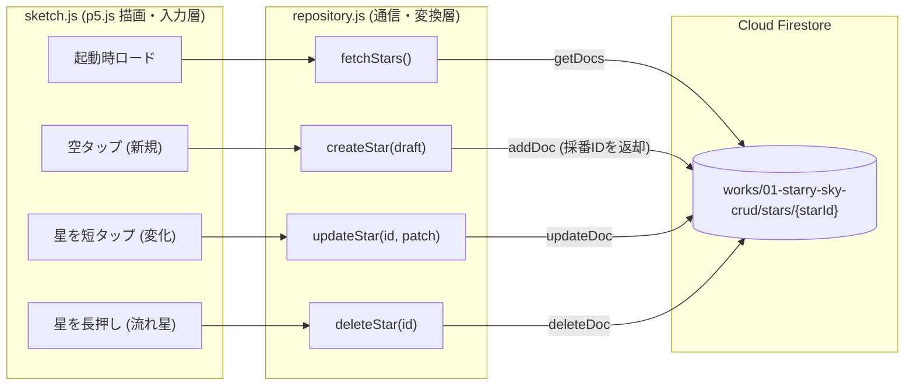

# 第1作 開発計画書：`01-starry-sky-crud`（星空の創造と編集）

シリーズの幕開けとなる第1作目（カード番号 `001 / LAB`）として、**「データベースのCRUD（作成・読取・更新・削除）とドキュメントIDの仕組み」**を、夜空の星を生み出し・育て・流れ星として還すインタラクティブアートで直感的に学ぶ作品を設計します。

---

## 1. コンセプトと学習設計（アート操作 × CRUD の1対1対応）

第2作（`onSnapshot` によるリアルタイム自動同期）への美しい伏線を作るため、第1作ではあえて **基本の単発クエリ（`getDocs`）＋ 個別ドキュメント操作（`addDoc` / `updateDoc` / `deleteDoc`）** で構成します。フォーム入力欄を一切使わず、PCのマウスでもスマホの指1本でも直感的に全操作が完結します。

| CRUD | 画面上のアート操作（PC / スマホ共通） | 視覚フィードバック | 使用する Firebase API |
| :--- | :--- | :--- | :--- |
| **Create** | 何もない夜空を **タップ（クリック）** | 波紋とともに新しい星が灯る | `addDoc` + `serverTimestamp` |
| **Read** | ページを開く / **再読み込み（F5）** | 保存されていた満天の星空が再現される | `getDocs` + `query` + `orderBy` + `limit` |
| **Update** | 既存の星を **短くタップ** | 星の色温度（4色）と等級（輝きの大きさ 1〜3）が変化する | `updateDoc` + `serverTimestamp` |
| **Delete** | 既存の星を **長押し（0.5秒ホールド）** | チャージリングが満ち、**流れ星**の軌跡を描いて消える | `deleteDoc` |

> [!TIP]
> **なぜ `createStar` の戻り値で ID を受け取るのか？（重要な学習ポイント）**
> `addDoc` 実行時に Firestore が自動採番した `docRef.id` を描画側の星オブジェクトへ保持させることで、「あとから特定の星だけを `updateDoc` / `deleteDoc` するには、座標ではなく一意な **ドキュメントID** を指定する必要がある」というDBの根本概念が自然に腹落ちします。

---

## 2. システム構成とデータフロー

---

## 3. データモデル設計

### Firestore コレクションパス
`/works/01-starry-sky-crud/stars/{starId}`（[`buildWorkCollectionPath`](../../../shared/firebase.js) で生成）

### フィールド仕様と `types.js`（JSDoc型定義）

| フィールド名 | Firestore型 | 許容範囲・制約 | 設計意図 |
| :--- | :--- | :--- | :--- |
| `normalizedX` | `int \| float` | `0.0 <= x <= 1.0` | PC（横長）とスマホ（縦長）で同じ星空空間を共有するための正規化X座標 |
| `normalizedY` | `int \| float` | `0.0 <= y <= 1.0` | 画面高さに対する正規化Y座標 |
| `colorIndex` | `int` | `0` 〜 `3` の整数 | 星の色温度パレット番号（`0`: 青白, `1`: 琥珀金, `2`: 桜桃, `3`: 氷青） |
| `magnitude` | `int` | `1` 〜 `3` の整数 | 星の明るさ段階（タップするたびに `1 → 2 → 3 → 1` と進化し十字フレアが伸びる） |
| `createdAt` | `timestamp` | `request.time` 一致 | 生成順の並び替え（`orderBy("createdAt", "asc")`）用・更新時も不変 |
| `updatedAt` | `timestamp` | `request.time` 一致 | 最終編集時刻の記録（Create時・Update時の双方でサーバー時刻を強制） |

- **`Star`（描画用ドメインモデル）**: `{ id: string, normalizedX: number, normalizedY: number, colorIndex: number, magnitude: number }`
- **`StarDraft`（Create入力用）**: `{ normalizedX: number, normalizedY: number, colorIndex: number, magnitude: number }`
- **`StarPatch`（Update入力用）**: `{ colorIndex: number, magnitude: number }`

---

## 4. ファイル別の責務と公開インターフェース

1. **`works/01-starry-sky-crud/end/repository.js`（および `start/repository.js`）**
   - `initializeSession(): Promise<SystemConnectionStatus>`
     - 未設定時はローカルフォールバック通知、設定時は匿名認証（`signInAnonymously`）でセッション確立。
   - `fetchStars(): Promise<Star[]>`
     - `getDocs` で最大 `120` 件を取得し、型ガード関数 `parseStarDocument` で不正データを除外して返却。
   - `createStar(draft: StarDraft): Promise<Star>`
     - `addDoc` で保存し、採番された `docRef.id` を付与した `Star` オブジェクトを返却。
   - `updateStar(starId: string, patch: StarPatch): Promise<void>`
     - `updateDoc` で `colorIndex`, `magnitude`, `updatedAt` のみを部分更新。
   - `deleteStar(starId: string): Promise<void>`
     - `deleteDoc` で対象ドキュメントを削除。

2. **`works/01-starry-sky-crud/end/sketch.js`（`start/sketch.js` と完全一致）**
   - `p.windowWidth` × `p.windowHeight` キャンバスと `p.windowResized` によるスマホ・PC両対応。
   - 短辺 `Math.min(p.width, p.height)` 基準の星サイズ・タップ判定半径（最低 `28px`）。
   - ポインタ押下時刻と対象星を記録し、`500ms` 未満で離せば `updateStar`、`500ms` 以上ホールドで流れ星エフェクト配列に追加しつつ `deleteStar` を呼ぶ。
   - 通信を待たずに画面がキビキビ反応するようローカル配列を即時更新し、万一通信失敗時はエラーを `#system-hud` に表示して状態を戻す。

3. **ギャラリーカード登録（[`assets/js/catalog.js`](../../../assets/js/catalog.js)）**
   - `id`: `"01-starry-sky-crud"` / `cardNumber`: `"001 / LAB"` / `stageLabel`: `"BASIC"` / `category`: `"crud"` / `characterId`: `"newt"`（ニュート） / `isTemplate`: `false`

4. **セキュリティルール（[`firestore.rules`](../../../firestore.rules)）**
   - `/works/01-starry-sky-crud/stars/{starId}` ブロックを追加。
   - `read`: `true`（公開鑑賞可）
   - `create`: 認証済み（匿名含む）かつ必須6フィールドのみ・型と数値範囲・`createdAt == request.time`・`updatedAt == request.time` を検証。
   - `update`: 認証済みかつ座標（`normalizedX`, `normalizedY`）と `createdAt` が変更されていないこと（`resource.data` と一致）、`colorIndex`（`0..3`）・`magnitude`（`1..3`）・`updatedAt == request.time` を検証。
   - `delete`: 認証済みであれば削除可（第1作では共有キャンバスの体験を優先し、UID単位の所有者ロックは第3作「認証・認可編」で導入する）。

